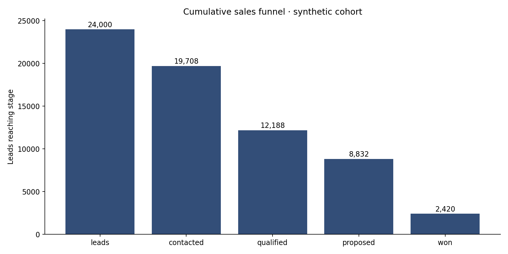
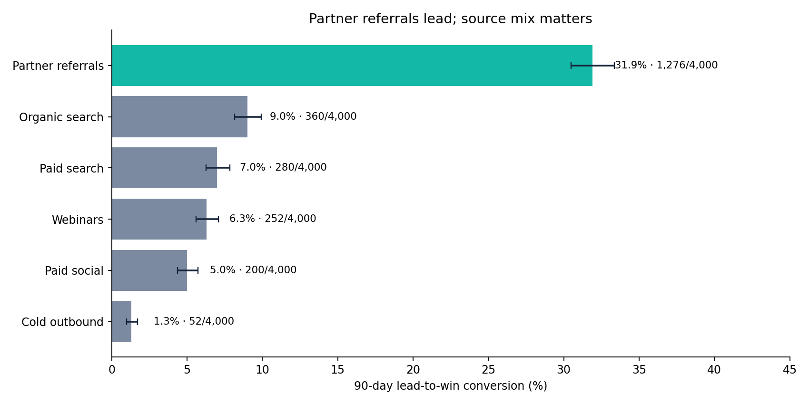

# B2B Sales Funnel & CRM Analysis

**Where is a B2B sales team losing leads, and what should it test first?**

This project analyzes 24,000 B2B leads using **SQL, Python and SQLite**. It tracks the lead-to-win funnel by source, sales rep and region, compares reps fairly after adjusting for lead quality, and proposes a small, controlled budget experiment.

> **About the data:** this is a **simulated-data project**. The 24,000 leads were generated by a seeded script (`src/generate_data.py`) because real company CRM data was not available. The headline figures (1.3%, 31.9%, 40%) were built into the simulation, so they show the analysis method, not real business results. No real budget was changed and no real stakeholders were involved.





## Key results (from the simulated data)

- **Source gap:** partner referrals converted at **31.9%** vs **1.3%** for cold outbound (about 24.5x, a 30.6 percentage-point gap).
- **Rep gap:** raw conversion ranged from 8.33% to 11.67% (a 40% relative gap). After adjusting for source mix, the gap shrank to about 35.6%, so lead source explains only part of it.
- **Recommendation:** investigate qualification and proposal stages first, then run a capped 8-week budget pilot instead of a full reallocation.

## Skills demonstrated

| Area | What I did |
|---|---|
| SQL | Joins, CTEs, aggregations and cohort filters across 10 named queries (SQLite) |
| Python | pandas for analysis, matplotlib for charts, automated reconciliation tests |
| Statistics | 90-day mature-cohort conversion, Wilson confidence intervals, source-mix standardization |
| Funnel analysis | Stage-by-stage drop-off, response time, cycle time and loss reasons |
| Business communication | Stakeholder memo with a decision request, pilot design and guardrails |
| Reproducibility | One command (`python run.py`) rebuilds data, tables, charts and the report |

## 1. Start here

You do not need to install anything to inspect the completed results. Extract this ZIP, then open **outputs/dashboard.html** in your browser. Keep its three PNG images alongside it. Read **docs/PROJECT_GUIDE.md** for the full walkthrough, **docs/STAKEHOLDER_MEMO.md** for recommendations and **docs/INTERVIEW_GUIDE.md** for explanations and interview questions.

To rebuild everything on Windows PowerShell:

```powershell
cd path\to\b2b-crm-analysis
py -m venv .venv
.\.venv\Scripts\Activate.ps1
python -m pip install -r requirements.txt
python run.py
python -m unittest discover -s tests -v
Start-Process outputs/dashboard.html
```

If PowerShell blocks activation, use `.\.venv\Scripts\python.exe -m pip install -r requirements.txt` and `.\.venv\Scripts\python.exe run.py` directly. There is no need to change your machine's execution policy.

On macOS/Linux:

```bash
cd b2b-crm-analysis
python3 -m venv .venv
source .venv/bin/activate
python -m pip install -r requirements.txt
python run.py
python -m unittest discover -s tests -v
```

The analysis uses Python, pandas, matplotlib and Python's built-in SQLite driver. No database server, API key, paid BI license or network connection is required after dependencies are installed. It was executed successfully with all five validation tests passing. Dependency ranges are compatibility ranges, not a frozen environment lock; the tested versions are recorded in outputs/environment.json.

## 2. Business questions

1. Which lead sources produce the highest 90-day lead-to-win conversion?
2. Which transition in the sales funnel merits investigation?
3. How much do representative results vary, before and after source adjustment?
4. Are regional differences large enough to warrant action?
5. Which channels warrant a controlled incremental investment test?
6. What would have to be true before a budget recommendation could become a business decision?

## 3. Verified headline results

| Metric | Reproduced result |
|---|---:|
| Unique leads | 24,000 |
| Won deals within 90 days | 2,420 |
| Overall conversion | 10.08% |
| Cold outbound | 52 / 4,000 = 1.3% |
| Partner referrals | 1,276 / 4,000 = 31.9% |
| Source rate ratio | 24.54× |
| Absolute source gap | 30.6 percentage points |
| Highest rep | R08: 350 / 3,000 = 11.67% |
| Lowest rep | R01: 250 / 3,000 = 8.33% |
| Relative rep gap | 40% |
| Absolute rep gap | 3.33 percentage points |

“24×” is an approximation, not the precise ratio. Prefer “24.5×” on a revised resume.

## 4. Repository map

| File / folder | Purpose |
|---|---|
| `run.py` | Rebuild data and all reports |
| `src/generate_data.py` | Seeded synthetic data generator |
| `src/analyze.py` | Execute SQL, intervals, charts and HTML report |
| `sql/schema.sql` | Schema, constraints, foreign keys and indexes |
| `sql/analysis.sql` | Ten named business queries |
| `data/leads.csv` | 24,000-row lead-level dataset |
| `data/reps.csv` | Eight sales representatives |
| `data/source_spend.csv` | Source-level cohort spend |
| `data/crm.sqlite` | Ready-to-query SQLite database |
| `outputs/*.csv` | Source, rep, source-rep-region, region, funnel, month, loss, response, cycle and adjusted-rep results |
| `outputs/dashboard.html` | Offline visual report with detailed tables |
| `outputs/*.png` | Three exportable charts |
| `outputs/metrics.json` | Machine-readable headline results |
| `notebooks/analysis_walkthrough.ipynb` | Optional notebook for inspecting outputs and trying queries |
| `docs/PROJECT_GUIDE.md` | Methodology, definitions, dictionary and implementation walkthrough |
| `docs/STAKEHOLDER_MEMO.md` | Decision-oriented report with experiment design |
| `docs/INTERVIEW_GUIDE.md` | Explanation, tradeoffs, questions and truthful resume wording |
| `tests/test_analysis.py` | Five meaningful integrity/reconciliation tests |

## 5. Scope and limitations

Lead-created cohorts run from 1 January through 30 June 2026. The snapshot is 30 September 2026. Every lead has at least 90 days of observation. All simulated closed outcomes occur inside 90 days, so simple won flags in secondary queries equal the 90-day metric in this release. If you import real data or extend the dates, apply the explicit mature-cohort CTE from `source_performance` to every secondary query before comparing results.

There is one lead per account and one deal per lead. The dataset intentionally has no duplicates or missing dimensions; stage nulls mean “not reached.” This is a clean simulated dataset, not proof of a completed real-world CRM cleanup. No budget was moved, no stakeholders were contacted, and no realized conversion or revenue improvement is claimed.

## 6. What to put on your resume after reviewing and running it

**B2B Sales Funnel & CRM Analysis — SQL, Python, SQLite**

- Built a reproducible analytics pipeline for 24,000 synthetic CRM leads, comparing source, representative and regional funnel performance.
- Quantified a designed 24.5× source conversion gap (1.3% vs. 31.9%) and 40% relative rep gap; evaluated source-adjusted performance and proposed a controlled budget-reallocation experiment.

For less emphasis on the engineered numbers, use: “Analyzed 24,000 simulated B2B leads using SQL and Python; built funnel and acquisition-cost reports, source-adjusted rep comparisons, and a budget experiment proposal.”
